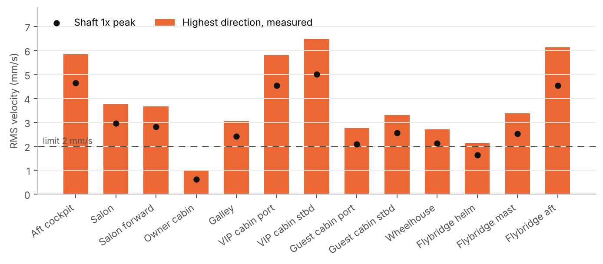
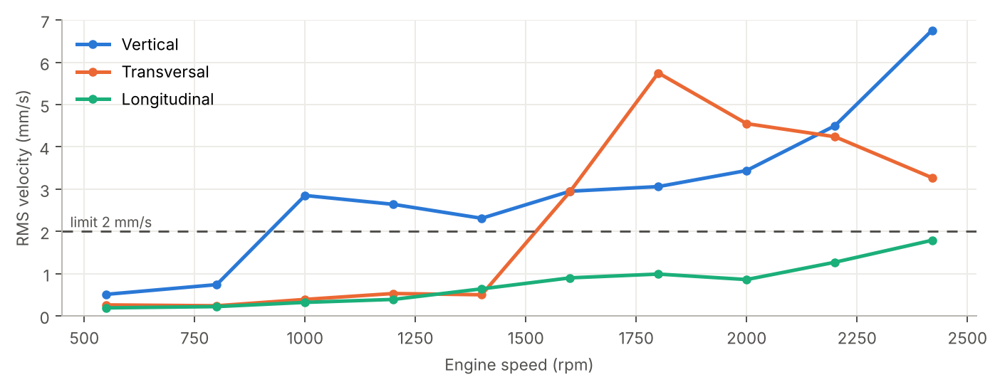
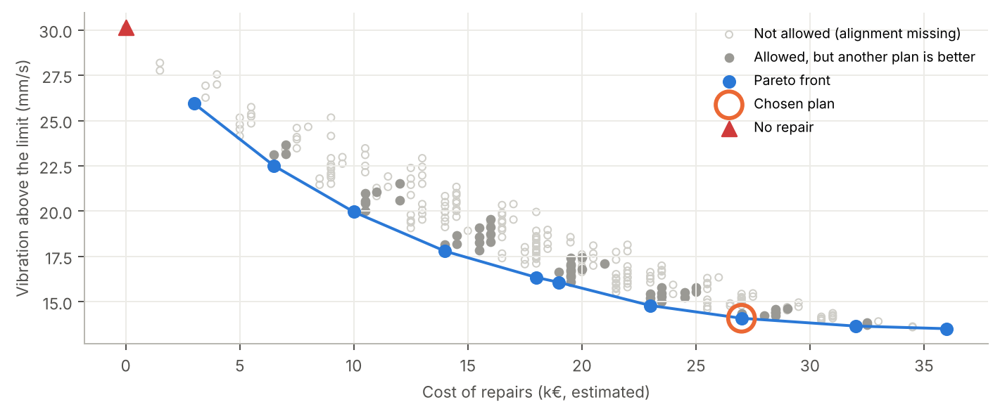
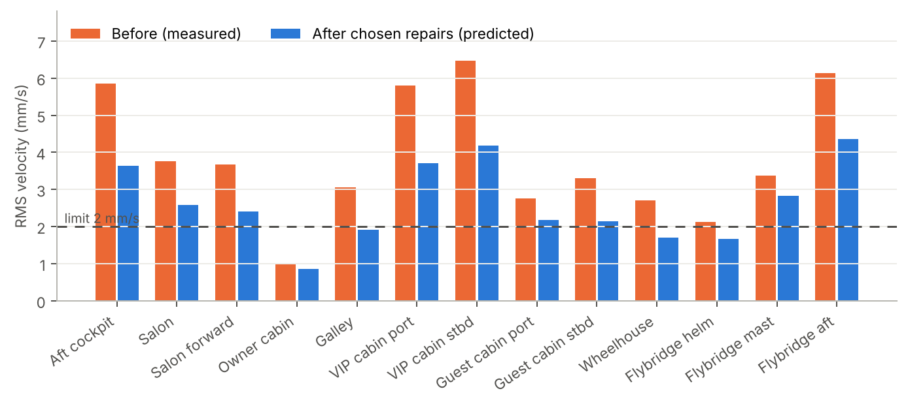
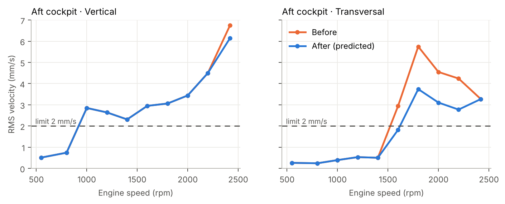

# Comfort vs Cost Optimization of Sea-Trial Vibration Analysis

A two-objective optimisation that turns a sea-trial vibration diagnosis into a repair decision: which shaft-line repairs to do, balancing **comfort** against **cost**.

During a sea trial on a motor yacht I found that most of the vibration on board came from the **shaft 1x** frequency, with the **starboard shaft line** the stronger of the two. A haul-out inspection a week later confirmed a shaft-line problem. The next question was: **which repairs should be done on each line**, so that comfort improves as much as possible without spending more than needed?

📄 Full write-up: [`report/Comfort_vs_Cost_Optimization_Sea_Trial_Vibration.pdf`](report/Comfort_vs_Cost_Optimization_Sea_Trial_Vibration.pdf)

> **About the data.** The case comes from my own sea-trial vibration analysis. For confidentiality, the yacht, model, shipyard and owner are not named, and the measured values have been randomly changed. The pattern of the problem, the root cause and the conclusions are the same as in the original analysis. Repair effects and costs are my own estimates.

## The sea trial

- 30–35 m GRP motor yacht with a planing hull, twin high-speed diesels, two shaft lines, 5-blade propellers
- Vibration velocity (RMS, 5–100 Hz) at **13 points × 3 directions** at cruise speed, an **RPM sweep** in the aft cockpit, and a **split-rpm test** to separate the two shaft lines
- Comfort limit: **2 mm/s RMS**

From 1,600 rpm to full speed the main peak follows the shaft rotation frequency, and at cruise the shaft 1x peak is the largest part of the vibration at almost every point.

## The model

**Decision variables:** $x_{r,l} \in \{0,1\}$, equal to 1 if repair $r$ is done on line $l$. There are 4 repairs × 2 lines, so 8 yes/no choices.

| Repair (per line) | Shaft vibration removed $e_r$ | Cost $c_r$ (estimate) |
|---|---|---|
| Shaft straightness check and correction | 40% | 9,000 € |
| Stern-tube and bracket bearings + seal renewal | 25% | 3,500 € |
| Propeller cleaning, reconditioning and balancing | 20% | 4,000 € |
| Shaft-line alignment | 15% | 1,500 € |

Line shares from the split-rpm test: starboard $w_S = 0.55$, port $w_P = 0.45$.

**Share of shaft vibration removed by a plan:**

$$R = \sum_{l} \sum_{r} w_l \, e_r \, x_{r,l}$$

**Vibration after the repairs** at each point, where $v$ is the measured value and $s$ the shaft peak (energies add as squares):

$$v_{after} = \sqrt{v^2 - s^2 + \big(s\,(1 - R)\big)^2}$$

**Objective 1 (comfort):** minimise the total vibration above the 2 mm/s limit

$$\min E = \sum_{points} \sum_{directions} \max\big(0,\ v_{after} - 2\big)$$

**Objective 2 (cost):**

$$\min C = \sum_{l} \sum_{r} c_r \, x_{r,l}$$

**Constraint:** the shafts were removed for inspection, so both lines must be realigned:

$$x_{alignment,\,port} = x_{alignment,\,stbd} = 1$$

**Choice:** find the Pareto front, then pick the plan with the lowest score

$$F = 0.7 \cdot \tilde E + 0.3 \cdot \tilde C$$

where both objectives are scaled from 0 (best) to 1 (worst) over the allowed plans.

With 8 yes/no choices there are $2^8 = 256$ plans, so I checked every one of them and the answer is exact. The same model also runs in Excel Solver (binary cells, Evolutionary method).

## Results

| # | Pareto-optimal plan | Cost | Above limit (mm/s) |
|---|---|---|---|
| 1 | Stbd: alignment · Port: alignment | 3,000 € | 25.9 |
| 2 | Stbd: bearings, alignment · Port: alignment | 6,500 € | 22.5 |
| 3 | Stbd: bearings, alignment · Port: bearings, alignment | 10,000 € | 20.0 |
| 4 | Stbd: bearings, propeller, alignment · Port: bearings, alignment | 14,000 € | 17.8 |
| 5 | Stbd: bearings, propeller, alignment · Port: bearings, propeller, alignment | 18,000 € | 16.4 |
| 6 | Stbd: shaft, bearings, alignment · Port: bearings, alignment | 19,000 € | 16.1 |
| 7 | Stbd: shaft, bearings, propeller, alignment · Port: bearings, alignment | 23,000 € | 14.8 |
| 8 | Stbd: shaft, bearings, propeller, alignment · Port: bearings, propeller, alignment | 27,000 € | 14.1 |
| 9 | Stbd: shaft, bearings, propeller, alignment · Port: shaft, bearings, alignment | 32,000 € | 13.7 |
| 10 | Stbd: shaft, bearings, propeller, alignment · Port: shaft, bearings, propeller, alignment | 36,000 € | 13.5 |

**Chosen plan (0.7 comfort / 0.3 cost):** Stbd: shaft, bearings, propeller, alignment · Port: bearings, propeller, alignment.
Vibration above the limit **30.1 → 14.1 mm/s (−53%)**, readings above the limit 18 → 14 of 39, cost about **27,000 €**.

In short: repair everything on the starboard line. On the port line, skip the shaft correction, because it costs 9,000 € and adds very little comfort.

**If priorities change:**

| Weights (comfort / cost) | Chosen plan | Cost | Above limit (mm/s) |
|---|---|---|---|
| 0.9 / 0.1 | Stbd: shaft, bearings, propeller, alignment · Port: shaft, bearings, alignment | 32,000 € | 13.7 |
| 0.7 / 0.3 | Stbd: shaft, bearings, propeller, alignment · Port: bearings, propeller, alignment | 27,000 € | 14.1 |
| 0.5 / 0.5 | Stbd: bearings, propeller, alignment · Port: bearings, alignment | 14,000 € | 17.8 |
| 0.3 / 0.7 | Stbd: bearings, alignment · Port: alignment | 6,500 € | 22.5 |

## What I learned

- The sea-trial data pointed to the right line, and the inspection confirmed it.
- Fixing the shaft lines doesn't fix everything. Even with every repair on both lines, 14 readings stay above the limit. That vibration comes from other sources (engine mounts, structure) and is useful input for the design of future hulls.
- Repair effects and costs are estimates. A sea trial after the repairs would give real numbers to update the model.

## Files

| Folder | Content |
|---|---|
| `data/` | Cruise survey, RPM sweep (mm/s RMS), repair options |
| `outputs/` | All 256 plans with cost, excess, Pareto flag and score; summary |
| `figures/` | Charts used above |
| `report/` | PDF write-up |

---
**Nakisa Piroozfar**, Strategic Industrial Engineer · vibration analysis, optimisation, SAP S/4HANA
